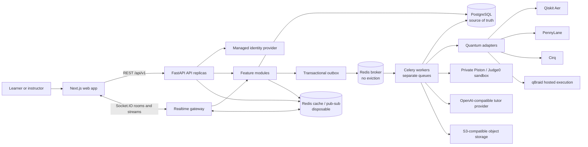
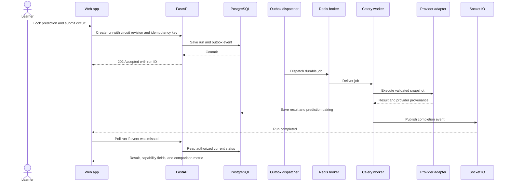
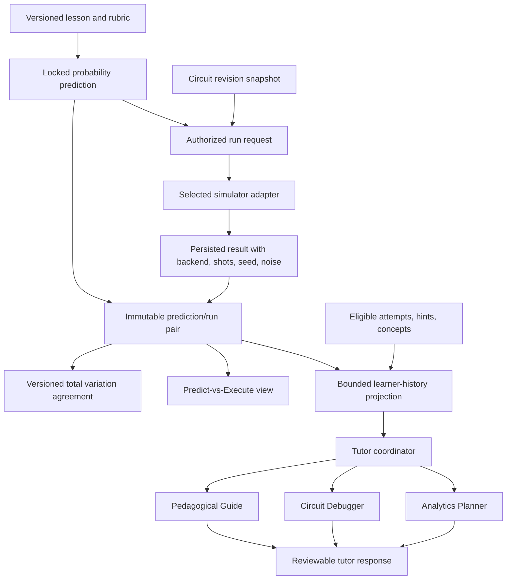
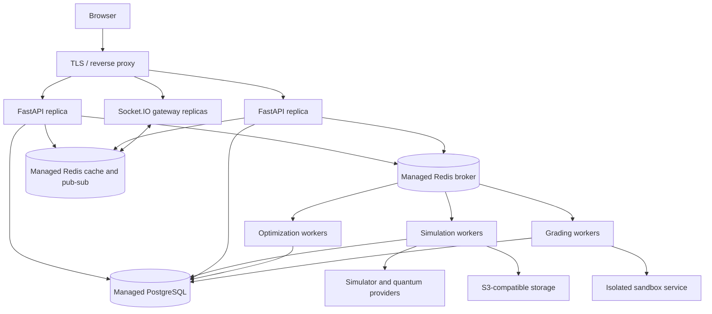

# QuantumLoop

**Learn quantum computing by predicting, building, running, and explaining circuits.** QuantumLoop combines an interactive circuit studio, guided labs, trusted assessments, and an AI tutor in a collaborative learning platform for students and instructors.

Learners make a prediction before a run, compare it with the measured result, inspect where it differs, and use that evidence to decide what to try next. Progress, experiments, coursework, and collaboration follow the learner across devices.

## Current working slice

The connected MVP currently covers Supabase signup, login, password recovery, and durable profiles; the Superposition lesson; owner-scoped saved circuits and immutable revisions; locked predictions; local Qiskit Aer runs through a worker; server-derived prediction comparisons; and run-bound tutor messages. The account home links directly to this path. The other frontend areas remain explicitly labeled demo experiences, and the wider backend features below are planned rather than release-ready. See [the implementation checklist](backend_plan.md) for acceptance status and [the contest log](contest_log.md) for completed increments.

For a local stack, use `docker compose --profile web up -d --build` after configuring the public Supabase and API settings described in [development.md](docs/development.md). The production frontend, API, PostgreSQL, Redis, and worker images currently boot together. A [Render deployment Blueprint and runbook](docs/deployment.md) are prepared; deployment to managed services and live multi-account acceptance are still open.

## Product roadmap

### Guided quantum learning

- A sequenced, faculty-reviewable curriculum with lessons, checkpoints, quizzes, concept references, prerequisites, and lesson resume.
- A nine-stage lab loop: **Learn → Predict → Build → Run → Observe → Explain → Debug → Challenge → Master**.
- A persistent Predict-vs-Execute view that compares a learner's locked probability prediction with the result paired to that run. It shows per-outcome changes, the comparison basis, shot count, and an interpretable agreement score.
- Interactive algorithms and workbenches for superposition, quantum gates, entanglement, Deutsch–Jozsa, Grover search, QFT, Shor, quantum error correction, QAOA, and VQE. Optimizers expose parameter evaluations and their histories.
- Application-oriented exercises connect algorithm ideas to optimization and simulation problems.

### Circuit Studio and quantum execution

- A visual circuit editor with gate placement, templates, circuit revisions, undo/redo, zoom, step inspection, visual, code, and split views.
- A synchronized readable gate sequence with keyboard controls for placing, inspecting, and editing circuits.
- QASM, Qiskit-style, JSON, and image exports, plus circuit sharing with access controls.
- A result workspace with measurement histograms, exact probabilities when available, sampled counts, statevectors, per-qubit Bloch data, circuit details, and step-by-step state inspection.
- A Noise Lab for studying ideal and noisy outcomes. Noise configuration, shots, seed, and backend travel with each result so comparisons retain their context.
- A common execution interface for **Qiskit Aer, PennyLane, Cirq, and qBraid**. Each adapter reports its supported gates, measurements, noise models, and result fields. Long or remote executions run asynchronously.
- Circuit interoperability and comparable result views across compatible frameworks, with conversions validated against each adapter's supported gate set and measurement conventions.
- QAOA Max-Cut and VQE optimization workbenches with bounded jobs, configurable parameters, progress, and evaluation histories.

### Circuit-aware AI tutor

The tutor uses one configurable OpenAI-compatible model interface and routes requests through a coordinator to focused roles:

- **Pedagogical Guide** explains the active lesson and concepts.
- **Circuit Debugger** gives incremental help grounded in the circuit and its run errors.
- **Analytics Planner** uses eligible prediction history, hints, and missed concepts to suggest a useful next experiment.

Responses can stream into the tutor drawer. Generated circuit suggestions arrive as reviewable previews that learners may apply or undo. The tutor does not grade work or expose assessment answers.

### Coursework and assessment

- Instructor-created quiz, code-response, and circuit-debug templates with reusable versions and learner previews.
- Versioned assignments with cohort or learner targeting, due dates, attached circuits, learner drafts, submissions, and written instructor feedback.
- Server-side quiz and circuit assessment. The server uses the published rubric and submitted circuit snapshot; it does not trust scores or results supplied by the browser.
- Narrative-led circuit challenges and sandboxed code challenges through Piston or Judge0, with execution limits, private test cases, and durable grading jobs.
- One learner assessment history spanning quizzes, labs, circuit challenges, code challenges, and assignments.

### Progress and teaching tools

- A dashboard and Quantum Passport with lesson progress, experiments, assessment history, concept mastery, prediction agreement history, streaks, XP, badges, and activity.
- Recommendations based on unfinished lessons, prerequisites, retries, and concepts needing practice, with an explanation for each suggestion.
- Instructor cohort dashboards, learner profiles, question-pattern analytics, assessment authoring, curriculum review, assignment delivery, and feedback.
- Shareable, verifiable completion credentials issued against server-recorded completion criteria.

### Collaboration and community

- Authenticated parties and study sessions with invitations, room membership, presence, and persistent chat.
- Shared circuit editing with ordered server revisions, conflict handling, reconnect recovery, and synchronized updates across backend instances.
- Contests with eligibility, schedules, trusted submissions, scoring, and global, contest, or module leaderboards across weekly and all-time views.
- Discussions with replies, sorting, voting, and contest-specific threads.

### Hardware and accessible interaction

- A quantum hardware catalog, stage-aware wiring studio, presets, save/load, 3D inspection, and server validation of components, ports, signal types, and thermal constraints.
- Keyboard-operable editing as an alternative to dragging, readable circuit and hardware representations, accessible status announcements, and numeric or tabular descriptions of visual results.
- Reduced-motion preferences and adjustable or removable timers where timed assessments are offered.
- Accessibility is designed against **WCAG 2.1 Level AA**. Conformance claims should be limited to the flows and assistive technologies that have completed the project's documented audit.

## Architecture

QuantumLoop uses a **modular monolith** for its application API, with separate worker processes for asynchronous and resource-heavy work. Feature modules own their routers, schemas, services, repositories, and migrations. They call each other through explicit public interfaces. Providers and quantum SDKs sit behind adapters, keeping feature behavior independent of individual vendors.



PostgreSQL holds durable identity mappings, learning records, circuits, assignments, submissions, assessment results, jobs, collaboration history, and audit events. Circuit snapshots and provider payloads use versioned JSON where appropriate. Large exports and artifacts live in object storage with ownership metadata in PostgreSQL. Broker Redis and evictable cache Redis are separate instances; losing a cache does not delete jobs or results.

### Feature modules

| Module | Responsibilities |
| --- | --- |
| Identity and cohorts | Provider JWT verification, profiles, preferences, roles, enrollment, invitations, cohort authorization |
| Curriculum and learning | Unit/lesson content, lesson sessions, predictions, experiment provenance, prerequisites |
| Circuits and artifacts | Circuit revisions, validation, sharing, imports, exports, signed object access |
| Experiments and optimization | Simulator adapters, remote-run tracking, QAOA/VQE jobs, normalized capability-aware results |
| Assessment and coursework | Templates, immutable assignment versions, drafts, server grading, feedback, unified attempts |
| Tutor | Context builder, role coordinator, streamed messages, provider limits, validated suggestions |
| Progress and analytics | Activity ledger, XP/badges, calibration projections, recommendations, instructor aggregates |
| Collaboration | Parties, invitations, presence, chat, shared circuit revisions and reconnect recovery |
| Community | Contests, trusted entries, score projections, leaderboards, discussions, replies, votes |
| Hardware | Component catalog, saved designs, compatibility, thermal validation |
| Operations | Health, structured errors, request/job correlation, outbox dispatch, reconciliation, audits |

### Async jobs and realtime updates

Simulation, optimization, code grading, large exports, and selected tutor work do not hold an HTTP request open. The API records an authorized job and an outbox event in one database transaction. Workers process queued tasks, persist results before publishing a notification, and expose status through an authorized polling endpoint. Socket.IO updates speed up the UI; PostgreSQL status and revision history allow clients to recover if they disconnect or miss an event.



Celery delivery is treated as **at least once**. Idempotency keys, durable job state, worker leases, and reconciliation prevent duplicate database effects. A provider timeout after accepting a request remains an explicit unknown/reconciliation state unless that provider supports idempotency or job lookup. The system does not claim exactly-once external execution.

### Learning and tutor context



Prediction agreement compares probability distributions using `1 − TVD`, where `TVD(p,q) = 0.5 × Σ|pᵢ − qᵢ|`. The result records whether the comparison uses an ideal distribution, noisy distribution, or sampled frequencies. It measures agreement for that attempt; it is not quantum state fidelity, learner confidence, or evidence of learning gain.

### Scale and deployment

The API and worker pools scale independently. Simulation, optimization, and grading queues have separate concurrency and resource limits, so CPU-heavy computation and untrusted code do not starve interactive API requests. Database pool budgets are calculated across all replicas and workers. PostgreSQL remains authoritative; Redis rankings and cache projections can be rebuilt from durable records.



Docker Compose supports local development and integration testing. GitHub Actions checks the backend, production frontend, browser journeys, migrations, and container stack. A manual release workflow publishes verified, commit-tagged images to GHCR. Production secrets, provider accounts, and deployment configuration are supplied by the selected hosting environment.

## Technology stack

| Layer | Technology |
| --- | --- |
| Frontend | Next.js, React, TypeScript, Zustand |
| API | Python 3.12, FastAPI, Pydantic |
| Persistence and migrations | PostgreSQL, SQLAlchemy, Alembic |
| Async work | Celery, Redis, transactional outbox |
| Realtime | Socket.IO, Redis pub/sub, durable PostgreSQL revisions |
| Quantum execution | Qiskit Aer, PennyLane, Cirq, qBraid adapters |
| Code execution | Private Piston or Judge0 sandbox |
| AI tutor | OpenAI-compatible chat completions interface |
| Artifacts | S3-compatible object storage |
| Local infrastructure | Docker, Docker Compose |
| CI and image release | GitHub Actions, GHCR |

## Local development

### Requirements

- Docker Desktop or Docker Engine with Docker Compose v2.
- For native development: Python 3.12 with [uv](https://docs.astral.sh/uv/), Node.js 22, and pnpm 10.13.1.
- Network access on the first build for package, container, and browser downloads.

### Start QuantumLoop

From the repository root:

```sh
docker compose --profile web up --build --wait
```

The command builds and starts PostgreSQL, separate broker and cache Redis services, database migrations, the FastAPI API, Celery workers, and the Next.js application.

| Service | URL |
| --- | --- |
| Web app | http://localhost:3000 |
| API | http://localhost:8000 |
| OpenAPI docs | http://localhost:8000/docs |
| API readiness | http://localhost:8000/api/v1/health/ready |
| API liveness | http://localhost:8000/api/v1/health/live |

To view service logs or stop the stack:

```sh
docker compose logs -f api worker
docker compose down
```

`docker compose down` retains local database and broker volumes. To delete local database/broker data, use `docker compose down --volumes`.

Host ports can be changed with `API_PORT`, `FRONTEND_PORT`, `POSTGRES_PORT`, `BROKER_PORT`, and `CACHE_PORT` if your machine already uses a default port.

### Native development

Start the stateful dependencies, then launch the API and worker in separate terminals:

```sh
docker compose up --wait db broker cache
cd backend
cp .env.example .env
uv sync --frozen
uv run --frozen alembic upgrade head
uv run --frozen uvicorn app.main:app --reload
```

In another terminal:

```sh
cd backend
uv run --frozen celery -A app.jobs.celery_app:celery_app worker --loglevel=INFO --concurrency=2
```

For frontend development, run `pnpm install --frozen-lockfile` and `pnpm dev` from `frontend/`.

## Testing and continuous integration

Each feature task has an acceptance suite in the backend implementation plan. The local checks are:

```sh
make backend-check backend-test
make test-integration
make frontend-check
```

Or run the complete suite with `make test-all`. Browser checks run against a production Next.js build; backend integration checks use PostgreSQL, Redis, and a live Celery worker. See [development and test guidance](docs/development.md) for prerequisites, migration workflow, report locations, and GitHub branch protection.

GitHub Actions runs backend lint, formatting, type, and unit checks; frontend production build, type, and Playwright checks; plus Docker migration and infrastructure integration checks on pushes and pull requests. A manual workflow publishes commit-tagged GHCR images after all required checks pass.

## API overview

All application routes are versioned under `/api/v1`. FastAPI exposes the OpenAPI schema at `/openapi.json` and interactive docs at `/docs`.

| Resource | Example responsibility |
| --- | --- |
| `/auth`, `/me`, `/cohorts` | Authenticated profiles, preferences, memberships, invitations |
| `/curriculum` | Units, lessons, question-safe learner content, resume state |
| `/circuits`, `/artifacts` | Owned circuits, revisions, sharing, exports |
| `/experiments/runs`, `/optimization/jobs` | Async quantum execution and QAOA/VQE work |
| `/predictions`, `/learners/{id}/attempts` | Locked predictions, trusted result pairs, assessment history |
| `/tutor` | Streamed circuit- and learner-aware guidance |
| `/assignments`, `/assessment-templates` | Publish, submit, grade, and review coursework |
| `/contests`, `/leaderboards`, `/community` | Entries, rankings, discussions, replies, votes |
| `/parties`, `/study-sessions` | Invitations, presence, chat, collaborative circuit revisions |
| `/hardware` | Catalog, saved designs, and validation diagnostics |
| `/jobs/{id}` | Authorized background job status, result, and cancellation |

The exact OpenAPI schema is the contract source for request fields, response capabilities, pagination, and structured errors. Actors are derived from verified auth tokens. Rubrics and trusted scores remain server-side.

## Security and reliability

- Managed authentication; FastAPI verifies signed identity tokens and enforces role, ownership, and cohort access.
- Private-by-default circuit and artifact access, signed object URLs, request limits, and audited instructor actions.
- Server-side quiz and circuit grading; isolated execution and resource limits for untrusted code.
- Durable PostgreSQL records for jobs, scores, revisions, and results; idempotent writes and reconciliation handle at-least-once queue delivery.
- Distinct Redis deployments for the broker and disposable cache/ranking data.
- Provider credentials kept in the deployment environment; bounded simulator jobs, AI usage, file sizes, and sandbox resources.
- Structured request/job correlation, health checks, backups, migration checks, and recovery procedures.

## Project structure

```text
.
├── .github/
│   ├── workflows/              # CI and manual GHCR publication
│   └── dependabot.yml
├── backend/
│   ├── app/
│   │   ├── core/               # Configuration and shared policies
│   │   ├── db/                 # SQLAlchemy base, pools, sessions
│   │   ├── integrations/       # Provider adapters
│   │   ├── jobs/               # Celery queues, tasks, dispatch
│   │   ├── modules/            # Feature-owned API and business logic
│   │   └── realtime/           # Socket.IO rooms and events
│   ├── migrations/             # Alembic schema history
│   └── tests/                  # Unit and real-service integration suites
├── docs/                       # Architecture review and development guide
├── frontend/                   # Next.js product experience
├── backend_plan.md             # Backend task plan and acceptance gates
└── compose.yaml                # Local API, database, workers, and web app
```

## Product and engineering references

- [Backend implementation plan](backend_plan.md)
- [Backend architecture review](docs/backend-review.md)
- [Development, Docker, and CI guide](docs/development.md)
- [Technology decisions](tech-stack-decisions.md)
- [Frontend route inventory](pages.md)
